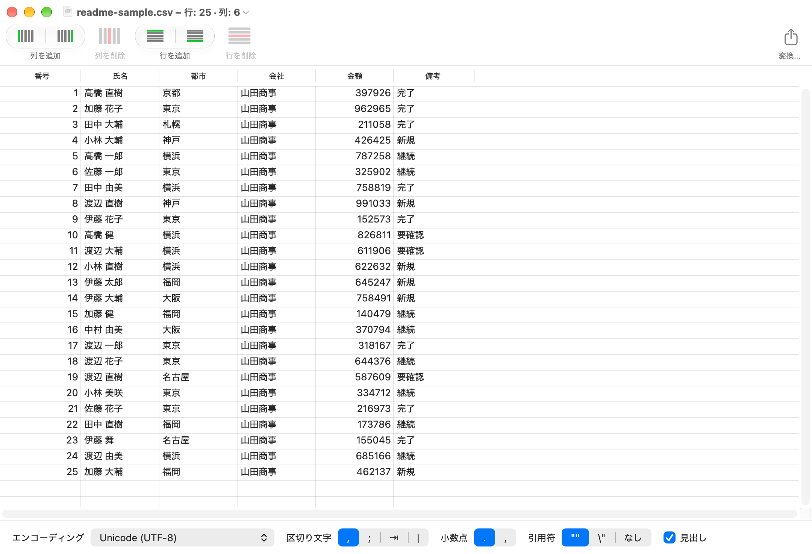

# Tabletool Swift

[English](README.md) · [简体中文](README.zh-Hans.md) · **日本語**

**Tabletool Swift** は、[Table Tool](https://github.com/jakob/TableTool)（オリジナル版 1.2.1）を Swift / AppKit で書き直した、シンプルでネイティブな macOS 用 CSV エディタです。Apple Silicon に対応しています。



## 特長

- **形式を自動判別**：エンコーディング（UTF-8/16/32、Shift-JIS、EUC-JP、ISO-2022-JP、GBK、GB18030、Windows-125x、MacRoman など）、区切り文字、引用符、小数点、見出し行を自動で判別します。誤判別は手動で修正できます。
- **データをそのまま保持**：先頭のゼロ、桁数の多い数値、Unicode の文字列をファイルの記述どおりに保ちます。
- **編集**：セルの編集、上下への行の追加、左右への列の追加、行・列の削除、列のドラッグによる並べ替え、取り消し／やり直し、コピー＆ペースト。
- **変換**：別名で保存するほか、エンコーディング・区切り文字・引用符・小数点・改行コードを変換したコピーを書き出せます。
- **高速**：5 MB の CSV を約 1 秒で開きます。
- **多言語対応**：英語、日本語、簡体字中国語。システムの言語に合わせて表示します。

## ダウンロード

[Releases](../../releases) ページから最新版をダウンロードし、解凍して **Tabletool Swift.app** を「アプリケーション」フォルダへドラッグしてください。macOS 13 以降、Apple Silicon が必要です。

アプリはまだ公証されていないため、初回は右クリックして「開く」を選ぶか、「システム設定 → プライバシーとセキュリティ」で許可してください。

## ビルド

macOS 13 以降と Xcode が必要です。外部ライブラリは使用していません。

```bash
open TabletoolSwift.xcodeproj      # Xcode で実行
# またはコマンドラインでビルド
xcodebuild -project TabletoolSwift.xcodeproj -scheme TabletoolSwift -configuration Release build
```

## テスト

```bash
cd CSVCore && swift test
```

コアライブラリの仕様は [CSVCore/CONTRACT.md](CSVCore/CONTRACT.md) を参照してください。

## 対象範囲

CSV の編集のみです。数式、スタイル、並べ替え、ネットワーク、データベースの機能はありません。

## 謝辞とライセンス

Table Tool は [Sandro Peham](https://github.com/SandroPeham)、[Andreas Aigner](https://github.com/aigi)、[Jakob Egger](https://github.com/jakob) によって作られました。Tabletool Swift はその Swift 書き直し版で、同じ [MIT ライセンス](LICENSE)で公開されています。
