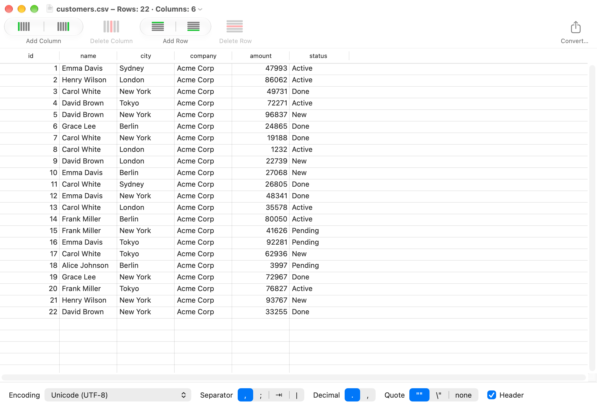

# Tabletool Swift

**English** · [简体中文](README.zh-Hans.md) · [日本語](README.ja.md)

**Tabletool Swift** is a rewrite of [Table Tool](https://github.com/jakob/TableTool) (original version 1.2.1) in Swift and AppKit: a simple, native macOS CSV editor for Apple Silicon.



## Features

- **Automatic format detection**: encoding (UTF-8/16/32, Shift-JIS, EUC-JP, ISO-2022-JP, GBK, GB18030, Windows-125x, MacRoman, …), delimiter, quoting, decimal mark and header row. Anything it gets wrong can be corrected by hand.
- **Your data stays as written**: leading zeros, very long numbers and Unicode text are kept exactly as they appear in the file.
- **Editing**: edit cells, add rows above or below, add columns left or right, delete rows and columns, drag columns to reorder, undo and redo, copy and paste.
- **Conversion**: save as, or convert encoding, delimiter, quoting, decimal mark and line endings into a copy.
- **Fast**: a 5 MB CSV opens in about a second.
- **Localized**: English, Japanese (日本語) and Simplified Chinese (简体中文), following your system language.

## Download

Get the latest build from the [Releases](../../releases) page: unzip it and drag **Tabletool Swift.app** to Applications. It needs macOS 13 or later on Apple Silicon.

The app is not notarized yet, so the first time you open it, right-click it and choose **Open** (or allow it under System Settings → Privacy & Security).

## Build

Requires macOS 13+ and Xcode. No third-party dependencies.

```bash
open TabletoolSwift.xcodeproj      # run from Xcode
# or from the command line
xcodebuild -project TabletoolSwift.xcodeproj -scheme TabletoolSwift -configuration Release build
```

## Test

```bash
cd CSVCore && swift test
```

The core library's contract is described in [CSVCore/CONTRACT.md](CSVCore/CONTRACT.md).

## Scope

CSV editing only: no formulas, styling, sorting, networking or databases.

## Credits and license

Table Tool was created by [Sandro Peham](https://github.com/SandroPeham), [Andreas Aigner](https://github.com/aigi) and [Jakob Egger](https://github.com/jakob). Tabletool Swift is a Swift rewrite of it and is released under the same [MIT License](LICENSE).
