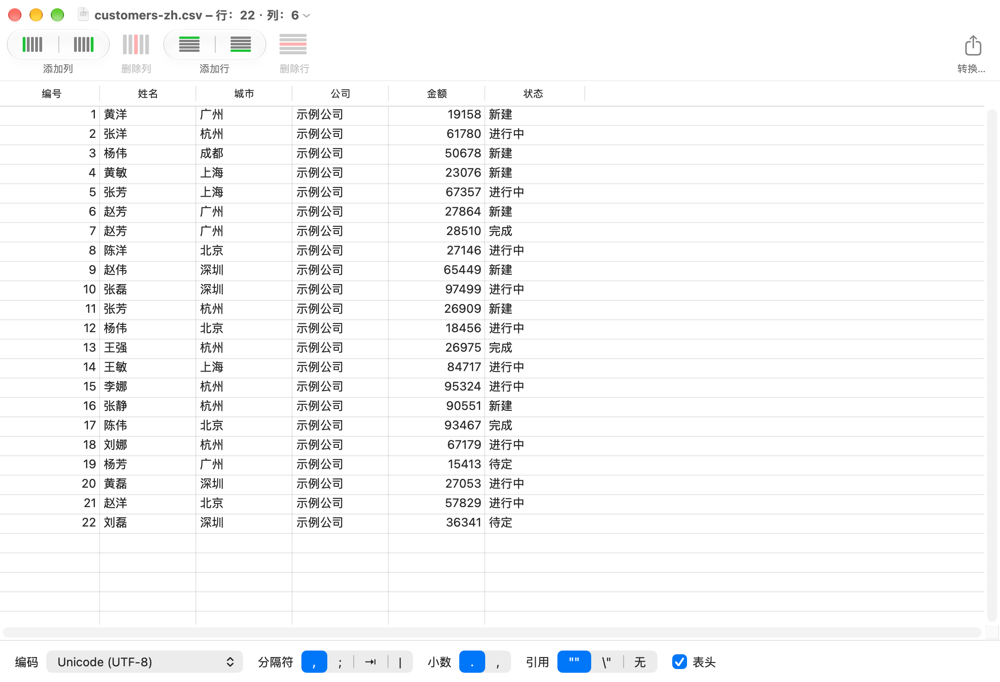

# Tabletool Swift

[English](README.md) · **简体中文** · [日本語](README.ja.md)

**Tabletool Swift** 是用 Swift / AppKit 重写的 [Table Tool](https://github.com/jakob/TableTool)（原版 1.2.1）：一个简单、原生的 macOS CSV 编辑器，面向 Apple Silicon。



## 特点

- **自动识别格式**：编码（UTF-8/16/32、Shift-JIS、EUC-JP、ISO-2022-JP、GBK、GB18030、Windows-125x、MacRoman 等）、分隔符、引号、小数点、是否有表头；识别有误时可手动纠正。
- **不改你的数据**：保留前导零、超长数字和 Unicode 单元格原文。
- **编辑**：单元格编辑、在上/下插入行、在左/右插入列、删除行列、列拖动重排、撤销重做、复制粘贴。
- **转换**：另存为，或转换编码、分隔符、引号、小数点、行尾并导出副本。
- **够快**：5MB 的 CSV 约 1 秒打开。
- **多语言**：英语、日语、简体中文，跟随系统语言。

## 下载

到 [Releases](../../releases) 页面下载最新版，解压后把 **Tabletool Swift.app** 拖到「应用程序」即可。需要 macOS 13 或更新，Apple Silicon。

应用暂未公证，首次打开请右键点击并选择「打开」（或在「系统设置 → 隐私与安全性」中放行）。

## 构建

需要 macOS 13+ 和 Xcode，无第三方依赖。

```bash
open TabletoolSwift.xcodeproj      # 在 Xcode 中运行
# 或命令行构建
xcodebuild -project TabletoolSwift.xcodeproj -scheme TabletoolSwift -configuration Release build
```

## 测试

```bash
cd CSVCore && swift test
```

核心库的接口约定见 [CSVCore/CONTRACT.md](CSVCore/CONTRACT.md)。

## 范围

只做 CSV 编辑：不提供公式、样式、排序、联网或数据库。

## 致谢与许可

Table Tool 由 [Sandro Peham](https://github.com/SandroPeham)、[Andreas Aigner](https://github.com/aigi) 和 [Jakob Egger](https://github.com/jakob) 创作；Tabletool Swift 是其 Swift 重写版本，沿用 [MIT 许可](LICENSE)。
